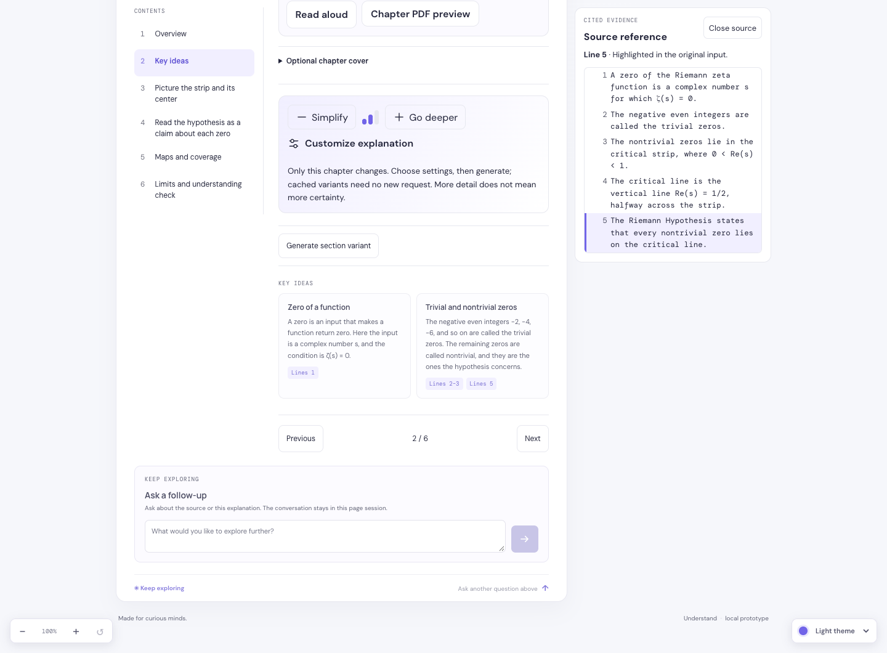
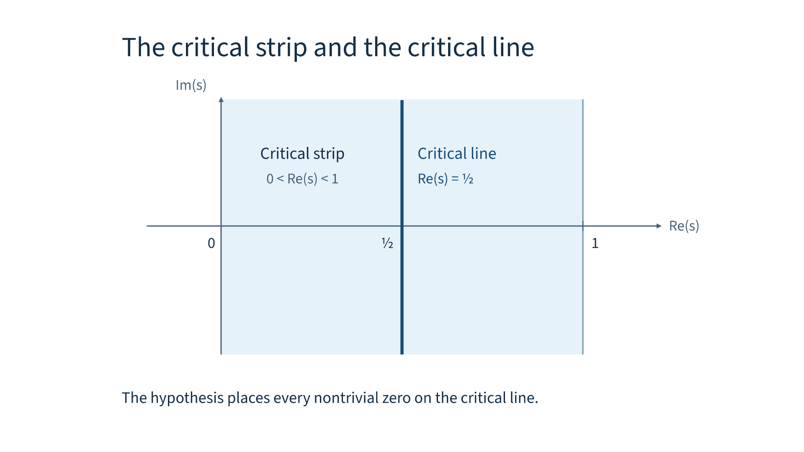
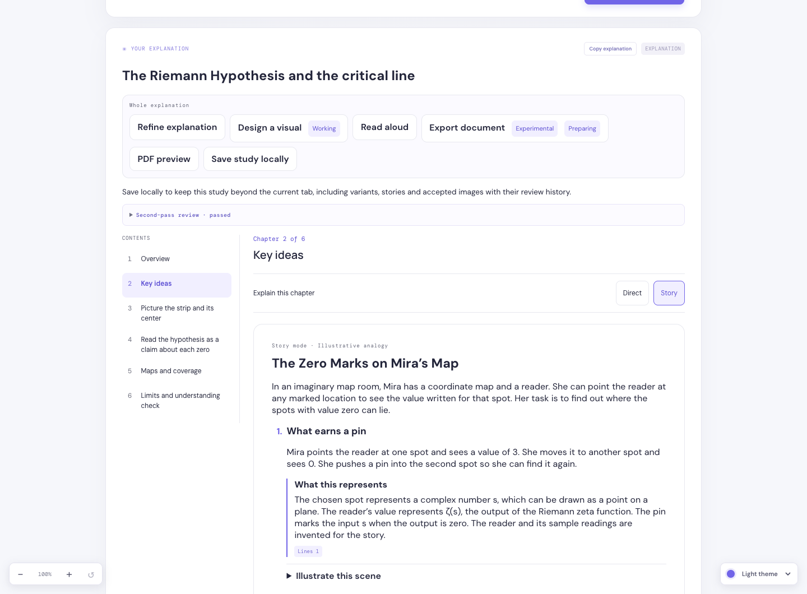
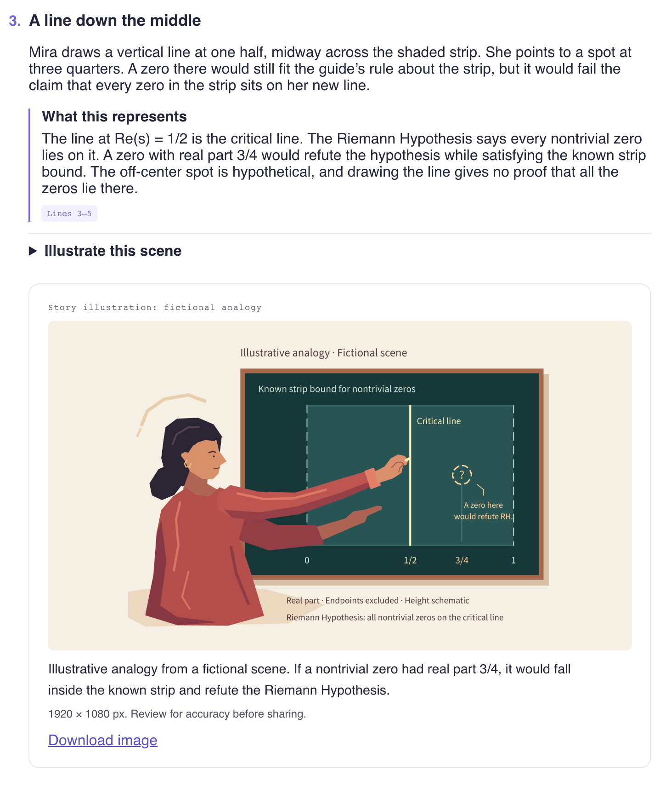
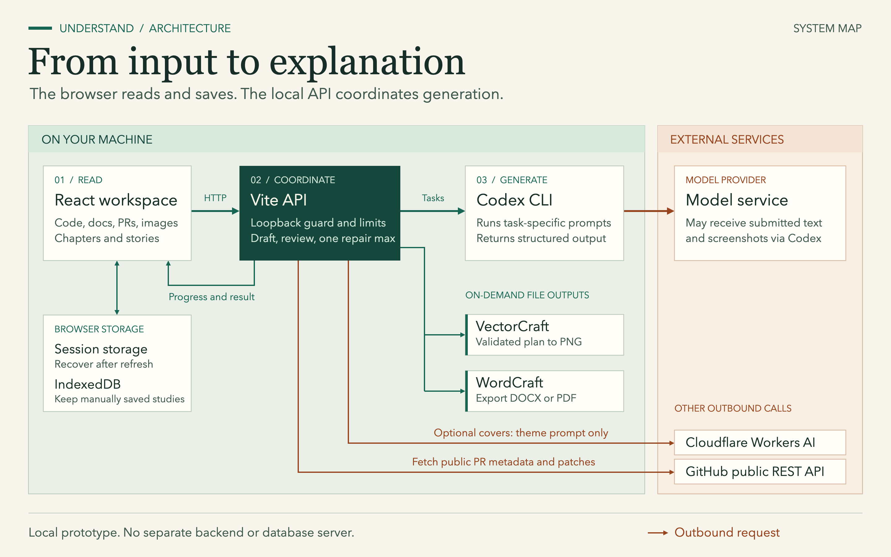
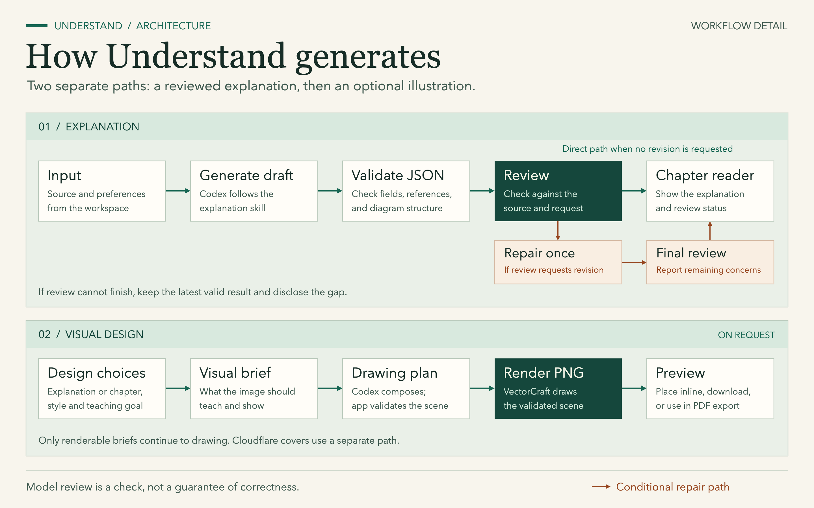

# Reading the Riemann Hypothesis with a Tool We Built

**Pull quotes**

- “A good outcome is when you can close the explanation and walk someone else through the idea in your own words.”
- “The critical strip tells us where to look. The Riemann Hypothesis says every nontrivial zero lies on one line inside it.”
- “When a claim matters, open its citation and check whether those lines support the exact claim.”

---

## Table of contents

1. [Why we built Understand](#1-why-we-built-understand)
2. [Why I chose the Riemann Hypothesis](#2-why-i-chose-the-riemann-hypothesis)
3. [The critical strip and the critical line](#3-the-critical-strip-and-the-critical-line)
4. [A worked example in Understand](#4-a-worked-example-in-understand)
5. [Where the explanation needed checking](#5-where-the-explanation-needed-checking)
6. [What else can you use Understand for?](#6-what-else-can-you-use-understand-for)
7. [How Understand works](#7-how-understand-works)
8. [Understanding what we build](#8-understanding-what-we-build)
9. [What’s next in the series](#9-whats-next-in-the-series)

## 1. Why we built Understand

Building with AI has changed how I write software. Once a feature works, it’s tempting to move straight to the next one. I’ve caught myself doing that before I could explain why the new code takes a particular path or what happens when a request fails.

Take the refresh feature in Understand. Refreshing the tab brings back the completed explanation and reopens the chapter you were reading without calling the model again. But what if the temporary copy contains a citation to a line that doesn’t exist? The app now checks the copy before restoring it. If the check fails, it discards the copy and keeps the editor usable. That’s the kind of question I want to be able to answer about a feature I’ve built, even after I’ve seen it work.

We built **Understand** to make that kind of reading easier. You can give it a piece of code, a passage from the docs, or a public pull request. As you read the explanation, you can open the source lines behind a claim and ask a follow-up about the part that still feels unclear. A good outcome is when you can close the explanation and walk someone else through the idea in your own words.

The Riemann Hypothesis gives us a timely way to try that. After seeing the headlines about a proof, I wanted to start with a more basic question: what does the hypothesis actually say?



*In Understand, clicking a citation opens the original passage beside the explanation and highlights the supporting line.*

## 2. Why I chose the Riemann Hypothesis

On November 20, 2026, mathematician Levent Alpöge announced that he and Claude had found a proof of the Riemann Hypothesis. He released the argument in Lean, a proof assistant that checks whether a formal argument establishes a precisely stated theorem. Researchers at MIT and the University of Waterloo reported successful machine checks, including checks with independently written proof checkers. As of November 24, the Clay Mathematics Institute lists the Riemann Hypothesis under **Active problems** on its Millennium Prize overview and labels the dedicated page **Active**. [Alpöge’s announcement](https://alpo.ge/remark.pdf) · [MIT verification record](https://math.mit.edu/~drew/grh/) · [Waterloo verification report](https://www.math.uwaterloo.ca/~mrubinst/alpoge_claude_grh/) · [Clay’s problem page](https://www.claymath.org/millennium/Riemann-Hypothesis/) · [Clay’s Millennium Prize overview](https://www.claymath.org/millennium-problems/)

I could follow the news about the proof and still struggle to explain the statement being proved. To understand it, I started with a picture of where the zeros in the hypothesis could lie.

## 3. The critical strip and the critical line

For the function $f(x)=x-2$, the number $2$ is a **zero** because putting $2$ into the function gives $0$. In the same way, a zero of the Riemann zeta function is an input $s$ for which $\zeta(s)=0$. The zeros at $-2,-4,-6,\ldots$ are called *trivial*. The hypothesis concerns the remaining zeros, called *nontrivial*. [Official problem description](https://www.claymath.org/wp-content/uploads/2022/05/riemann.pdf)

You can picture a complex number $s$ as a point on a map. Its **real part**, written $\operatorname{Re}(s)$, tells you how far left or right it sits. The **critical strip** is the region between horizontal coordinates $0$ and $1$, where all nontrivial zeros are known to lie. The **critical line** runs vertically through $1/2$. The hypothesis says that every nontrivial zero lies on that line. [NIST Digital Library of Mathematical Functions](https://dlmf.nist.gov/25.10#i)



*The shaded strip shows the known region. The dark vertical line at $\operatorname{Re}(s)=1/2$ shows where the hypothesis places every nontrivial zero.*

The location matters because it controls how closely estimates of the number of primes match the actual count. [Clay Mathematics Institute overview](https://www.claymath.org/millennium/Riemann-Hypothesis/)

This gives us a question to try in Understand. **What would it mean to find a nontrivial zero inside the strip, but off the line?**

## 4. A worked example in Understand

To follow along, clone the repository and open `code-understanding-tool`. Run `npm install` to install the dependencies, then `npm run dev` to start the app. Generation uses your signed-in Codex CLI and may send the submitted material to its configured service. [Understand source code on GitHub](https://github.com/ChaitanyaPandit1998/gpt-under-the-hood/tree/main/code-understanding-tool)

I opened **Documentation**, pasted the five-line passage below, chose **Beginner** and **Step-by-step**, and clicked **Help me understand**.

```text
A zero of the Riemann zeta function is a complex number s for which ζ(s) = 0.
The negative even integers are called the trivial zeros.
The nontrivial zeros lie in the critical strip, where 0 < Re(s) < 1.
The critical line is the vertical line Re(s) = 1/2, halfway across the strip.
The Riemann Hypothesis states that every nontrivial zero lies on the critical line.
```

In the **Key ideas** chapter, I clicked a citation beside the explanation of trivial and nontrivial zeros. Understand opened the original passage alongside the explanation and highlighted line 5. I could see exactly where the source said **every** nontrivial zero lies on the line.

Then I asked a follow-up. **What would a nontrivial zero inside the strip but off the line mean for the hypothesis?** The app pointed to lines 3–5. Such a zero would fit the known bounds of the strip. It would also be enough to disprove the hypothesis, because the hypothesis puts every nontrivial zero on the line.

I switched the same chapter from **Direct** to **Story**. In *The Zero Marks on Mira’s Map*, Mira puts a pin wherever an imaginary reader displays zero. The **What this represents** panel maps each part of the scene to the math. The spot on the map is the input $s$, the reading is $\zeta(s)$, and the pin marks a spot where that reading is zero.

Later, Mira points to a hypothetical spot at horizontal position $3/4$. I used **Illustrate this scene** to render that moment with VectorCraft. I could now say why it mattered in my own words. **A zero there would be inside the strip, and it would be off the line.**



*In the app, Story Mode puts Mira’s analogy beside its mathematical meaning and links back to the source.*



*The illustration appears directly under Mira’s scene in Story Mode. The question mark at $3/4$ shows where a hypothetical counterexample could lie.* [View the full-size VectorCraft illustration](riemann-hypothesis-assets/vectorcraft-miras-map.png)

## 5. Where the explanation needed checking

One draft diagram labelled the critical strip but drew only the critical line. I revised it to shade the region between 0 and 1 and show the line at ½. I also removed the word “unproved” from the image labels because the five-line passage never discussed the status of the proof.

In an earlier Story Mode run, the app described a half-turn around the wrong centre. The story had passed the app’s review. Comparing the description with the transformation exposed the error.

That’s part of what I wanted from Understand. For the story, I could compare the description with the math it represented. For the diagram, I could check whether the picture showed both things the explanation described. In each case, I had something specific to verify.

## 6. What else can you use Understand for?

The Riemann Hypothesis was my test case. The same reading process applies to the material we work with every day. Start with the passage, function, or diff in front of you and ask one question about it.

| What you’re reading | A question to start with | What to do in Understand |
| --- | --- | --- |
| **Documentation** | In a cache-aside system, what happens on a cache miss? When does the cache get invalidated? | Paste the relevant passage. Trace the sequence in the explanation and open a citation to see what the source says about invalidation. |
| **Unfamiliar code** | When does this retry function make another attempt, and when does it throw? | Paste the function. Read the walkthrough and, if the app generates a diagram, follow each branch back to the condition in the code. |
| **A public GitHub pull request** | Which change affects behavior, and which patch shows it? | Load the PR and generate an explanation for the chapter you care about. Check the pinned revision and file list to see which patches the app had available. |

If the material is in a screenshot, you can upload it and correct the extracted text before asking for an explanation. Choose **Start a quick check** for three questions about what you just read, or save the study locally and come back to it later.

## 7. How Understand works

Understand runs as a React app in the browser and talks to a Vite API on the same machine. When I clicked **Help me understand**, the browser sent the five-line passage, my audience level, and my chosen depth to that API. While the API was working, the browser polled it for progress. The original request returned the completed explanation. Explicitly saved studies stay in the browser’s IndexedDB.



*The overview shows where each step runs. The numbered path follows an explanation request. The branches show browser storage, on-demand exports, and calls to external services.*

The API loads instructions for the explanation task and passes them with the source to Codex CLI, which can call its configured model service. Codex returns a JSON draft with sections and source line ranges. The API validates the draft, then runs a separate review against the source. If the review requests changes, the app makes one repair attempt and reviews the result again. If review can’t finish, the app keeps the latest structurally valid result and shows that the review is incomplete. The browser turns the result into chapters and uses the returned ranges to highlight the cited lines.

**Story** requests an analogy for the selected chapter. Illustrating it is a separate workflow. For Mira’s scene, I chose **Story illustration**, then clicked **Generate visual brief** and **Render image**. Codex produced the brief and drawing plan in separate requests. The app checked the plan, then VectorCraft rendered the PNG and the browser showed it inline. A brief can also recommend keeping the idea in text, in which case the workflow stops before drawing. [Architecture guide on GitHub](https://github.com/ChaitanyaPandit1998/gpt-under-the-hood/blob/main/code-understanding-tool/docs/architecture.md)



*The workflow diagram shows where the optional repair happens and how a visual goes from design choices to an inline PNG.*

## 8. Understanding what we build

I started with a headline about a proof. By the end, I could explain what the Riemann Hypothesis says and why one nontrivial zero off the critical line would be enough to disprove it. The moment I knew I understood it was when I could answer that follow-up in my own words.

That’s the habit I want to bring back to building with AI. When a generated function works, I can pick one branch and ask what would happen if the input changed. If I can predict the result and point to the lines that explain it, I’m in a better position to make the next change.

## 9. What’s next in the series

- **Part 2 — How Understand generates source-linked explanations.** I’ll follow one request from the browser to Codex CLI and back. We’ll look at how the response becomes chapters, how the app checks citation ranges, and what happens when the review asks for a correction.
- **Part 3 — Reading a large pull request one chapter at a time.** I’ll use a public GitHub PR to show how Understand pins a revision, groups changes into chapters, and lets you check what the available patches actually show, even when some are missing or incomplete.
- **Part 4 — When diagrams and stories help explain code.** I’ll compare an interactive diagram you can trace back to the code with a fictional scene that links back to the source. I’ll also show how a visual brief becomes an inline VectorCraft illustration.
- **Part 5 — What the evaluations caught.** I’ll show what the app’s automated tests cover and what we learned from runs with the model. One retry diagram looked plausible but left out the arrow that shows the operation being tried again.

## Further reading

- [Riemann’s 1859 manuscript and its connection to counting primes](https://www.claymath.org/collections/riemanns-1859-manuscript/)
- [Enrico Bombieri’s official mathematical description of the problem](https://www.claymath.org/wp-content/uploads/2022/05/riemann.pdf)
- [Michael Rubinstein’s working guide to the announced Lean proof](https://www.math.uwaterloo.ca/~mrubinst/alpoge_claude_grh/)
