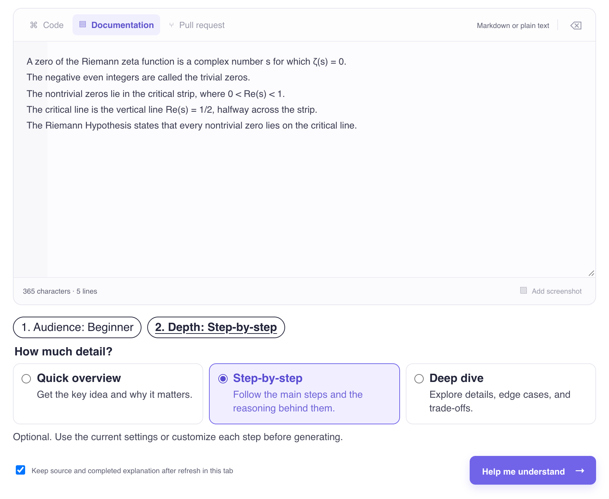

# I Built an AI Tool for Reading Code. Then I Gave It the Riemann Hypothesis.

**Pull quotes**

- “A good outcome is when you can close the explanation and walk someone else through the idea in your own words.”
- “The critical strip tells us where to look. The Riemann Hypothesis says every nontrivial zero lies on one line inside it.”
- “When a claim matters, open its citation and check whether those lines support the exact claim.”

---

## Table of contents

1. [Why we built Understand](#1-why-we-built-understand)
2. [Why I chose the Riemann Hypothesis](#2-why-i-chose-the-riemann-hypothesis)
3. [The critical strip and the critical line](#3-the-critical-strip-and-the-critical-line)
4. [A worked example in Understand](#4-a-worked-example-in-understand)
5. [Where the explanation needed checking](#5-where-the-explanation-needed-checking)
6. [What else can you use Understand for?](#6-what-else-can-you-use-understand-for)
7. [How Understand works](#7-how-understand-works)
8. [Understanding what we build](#8-understanding-what-we-build)
9. [What’s next in the series](#9-whats-next-in-the-series)

## 1. Why we built Understand

AI helps me get to working code faster. I’ve caught myself moving on to the next feature before I could explain the one I’d just built. That catches up with me when I need to change it. Say I ask AI to add retries to a request. When the last attempt fails, what does the caller actually get back? Which line decides?

We built **Understand** to help me answer questions like that from the source. I can give it a piece of code, a passage from the docs, or a public pull request. It breaks the material into chapters, and I can click a citation to read the lines behind a claim. If a step still feels unclear, I can ask about that specific part and keep reading.

A good outcome is when you can close the explanation and walk someone else through the idea in your own words. With code, I want to go one step further. If I change an input or a condition, I want to be able to predict what happens and point to the lines that explain why.

The Riemann Hypothesis gives us a timely way to try that. After seeing the headlines about a proof, I wanted to start with a more basic question: what does the hypothesis actually say?


*I pasted a five-line passage into Understand, opened the Key ideas chapter, and clicked the citation for line 5. The panel on the right shows the original passage and highlights the line that says every nontrivial zero lies on the critical line.*

## 2. Why I chose the Riemann Hypothesis

- **The announcement.** On November 20, 2026, mathematician Levent Alpöge announced that he and Claude had found a proof. He released the argument in Lean, a tool that checks whether a formal argument establishes a precisely stated theorem. [Alpöge’s announcement](https://alpo.ge/remark.pdf)
- **The machine checks.** Researchers at MIT and the University of Waterloo reported successful checks, including checks with independently written proof checkers. [MIT verification record](https://math.mit.edu/~drew/grh/) · [Waterloo verification report](https://www.math.uwaterloo.ca/~mrubinst/alpoge_claude_grh/)
- **Clay’s listing.** As of November 24, the Clay Mathematics Institute lists the hypothesis under **Active problems** on its Millennium Prize overview and labels the dedicated page **Active**. [Clay’s problem page](https://www.claymath.org/millennium/Riemann-Hypothesis/) · [Clay’s Millennium Prize overview](https://www.claymath.org/millennium-problems/)

I could follow the news about the proof and still struggle to explain the statement being proved. To understand it, I started with a picture of where the zeros in the hypothesis could lie.

## 3. The critical strip and the critical line

A **zero** is an input that gives you 0. Say your rule is “subtract 2.” Put in 2 and you get 0, so 2 is a zero of that rule. The Riemann zeta function has zeros too. The ones at −2, −4, −6, and so on are called *trivial*. All the others are called *nontrivial*, and those are the zeros the hypothesis is about. [Official problem description](https://www.claymath.org/wp-content/uploads/2022/05/riemann.pdf)

Picture each complex number as a point on a map. Its left-to-right position is called its **real part**. Here’s how to read the diagram.

- **The shaded strip.** All nontrivial zeros are known to sit somewhere between 0 and 1 on the horizontal axis.
- **The centre line.** It runs vertically through ½. The hypothesis says every one of those zeros lies on this line. [NIST Digital Library of Mathematical Functions](https://dlmf.nist.gov/25.10#i)


*The shaded strip shows the known region. The dark vertical line at Re(s) = ½ shows where the hypothesis places every nontrivial zero.*

The location matters because it controls how closely estimates of the number of primes match the actual count. [Clay Mathematics Institute overview](https://www.claymath.org/millennium/Riemann-Hypothesis/)

## 4. A worked example in Understand

On Mira’s map, there’s a question mark at ¾. It sits inside the shaded strip, to the right of the centre line at ½. **Imagine the zeta function returned zero at that point. Which statement would still hold, and which would fail?** Take a moment to work it out before reading on.

When I asked Understand what a nontrivial zero inside the strip but off the line would mean, this was the first sentence of its reply.

> A single nontrivial zero off the critical line would disprove the Riemann Hypothesis.

Here’s how I set up the run.

1. Open **Documentation** and paste the five-line passage below.
2. Choose **Beginner** and **Step-by-step**.
3. Click **Help me understand**.

```text
A zero of the Riemann zeta function is a complex number s for which ζ(s) = 0.
The negative even integers are called the trivial zeros.
The nontrivial zeros lie in the critical strip, where 0 < Re(s) < 1.
The critical line is the vertical line Re(s) = 1/2, halfway across the strip.
The Riemann Hypothesis states that every nontrivial zero lies on the critical line.
```



*The setup just before I clicked Help me understand. The passage is in the Documentation tab, with the audience set to Beginner and the depth set to Step-by-step.*

The follow-up answer pointed me to three lines.

- **Line 3** puts nontrivial zeros inside the strip, between 0 and 1. A zero at ¾ would fit that rule.
- **Line 4** puts the critical line at ½, so the spot at ¾ is off the line.
- **Line 5** says **every** nontrivial zero lies on that line. One zero at ¾ would be enough to refute the claim. I could also open line 5 from the citation in the **Key ideas** chapter, as shown at the start of the article.

I switched the same chapter from **Direct** to **Story**. In *The Zero Marks on Mira’s Map*, Mira puts a pin wherever an imaginary reader displays zero. The **What this represents** panel maps each part of the scene to the math. The spot on the map is the input s, the reading is ζ(s), and the pin marks a spot where that reading is zero.


*In the app, Story Mode puts Mira’s analogy beside its mathematical meaning and links back to the source.*

The last scene is where Mira points to the spot at ¾. I used **Illustrate this scene** to render that moment with VectorCraft. I could read the story, check its explanation against lines 3–5, and see where the point would sit on the map.


*The illustration appears directly under Mira’s scene in Story Mode. The question mark at ¾ shows where a hypothetical counterexample could lie.* [View the full-size VectorCraft illustration](riemann-hypothesis-assets/vectorcraft-miras-map.png)

To try it yourself, [open the project on GitHub](https://github.com/ChaitanyaPandit1998/gpt-under-the-hood/tree/main/code-understanding-tool) and follow these steps.

1. Clone the repository and open `code-understanding-tool`.
2. Run `npm install` to install the dependencies.
3. Run `npm run dev` to start the app.

Generation uses your signed-in Codex CLI and may send the submitted material to its configured service.

## 5. Where the explanation needed checking

- **The missing strip.** One draft diagram labelled the critical strip but drew only the critical line. I shaded the region between 0 and 1 and kept the line at ½.
- **A claim beyond the source.** The image labels said “unproved.” I removed that word because the five-line passage never discussed the status of the proof.
- **The wrong centre.** In an earlier Story Mode run, the app described a half-turn around the wrong centre. The story passed the app’s review. Comparing the description with the rotation exposed the error.

That’s part of what I wanted from Understand. For the story, I could compare the description with the math it represented. For the diagram, I could check whether the picture showed both things the explanation described. In each case, I had something specific to verify.

## 6. What else can you use Understand for?

The Riemann Hypothesis was my test case. The same reading process applies to the material we work with every day. Start with the passage, function, or diff in front of you and ask one question about it.

- **Documentation.** Ask what happens on a cache miss or when the cache gets invalidated. Paste the relevant passage and open a citation to check the sequence.
- **Unfamiliar code.** Ask when a retry function makes another attempt and when it throws. Read the walkthrough and, if the app generates a diagram, trace each branch back to the condition in the code.
- **A public GitHub pull request.** Ask which change affects behavior and which patch shows it. Generate an explanation for the chapter you care about, then check the pinned revision and file list to see which patches were available.
- **A screenshot.** Upload it and correct the extracted text before asking for an explanation.

Choose **Start a quick check** for three questions about what you just read, or save the study locally and come back to it later.

## 7. How Understand works

Understand runs as a React app in the browser and talks to a Vite API on the same machine. Explicitly saved studies stay in the browser’s IndexedDB.


*The overview shows where each step runs. The numbered path follows an explanation request. The branches show browser storage, on-demand exports, and calls to external services.*

**From source text to a cited explanation**

1. **Send the request.** When I clicked **Help me understand**, the browser sent the passage, audience level, and reading depth to the API. It checked for progress while the original request stayed open.
2. **Generate a draft.** The API sent the source and task instructions to Codex CLI, which can call its configured model service. Codex returned a JSON draft with sections and source line ranges.
3. **Validate and review.** The API checked the draft’s structure and separately reviewed it against the source. If the review asked for changes, the app made one repair attempt and reviewed it again. If review couldn’t finish, the app kept the latest structurally valid result and showed that the review was incomplete.
4. **Show the result.** The original request returned the completed explanation. The browser displayed it as chapters and used the line ranges to highlight the cited source text.

**From a story scene to an illustration**

1. Choose **Story** to request an analogy for the selected chapter.
2. Choose **Story illustration** and click **Generate visual brief**. A brief can recommend keeping the idea in text, ending the workflow there.
3. Click **Render image**. Codex produces a drawing plan in a separate request. The app checks the plan, VectorCraft renders the PNG, and the browser shows it inline. [Architecture guide on GitHub](https://github.com/ChaitanyaPandit1998/gpt-under-the-hood/blob/main/code-understanding-tool/docs/architecture.md)


*The workflow diagram shows where the optional repair happens and how a visual goes from design choices to an inline PNG.*

## 8. Understanding what we build

I started with a headline about a proof. By the end, I could explain what the Riemann Hypothesis says and why one nontrivial zero off the critical line would be enough to disprove it. The moment I knew I understood it was when I could answer that follow-up in my own words.

That’s the habit I want to bring back to building with AI. When a generated function works, I can pick one branch and ask what would happen if the input changed. If I can predict the result and point to the lines that explain it, I’m in a better position to make the next change.

## 9. What’s next in the series

- **Part 2 — How Understand generates source-linked explanations.** I’ll follow one request from the browser to Codex CLI and back. We’ll look at how the response becomes chapters, how the app checks citation ranges, and what happens when the review asks for a correction.
- **Part 3 — Reading a large pull request one chapter at a time.** I’ll use a public GitHub PR to show how Understand pins a revision, groups changes into chapters, and lets you check what the available patches actually show, even when some are missing or incomplete.
- **Part 4 — When diagrams and stories help explain code.** I’ll compare an interactive diagram you can trace back to the code with a fictional scene that links back to the source. I’ll also show how a visual brief becomes an inline VectorCraft illustration.
- **Part 5 — What the evaluations caught.** I’ll show what the app’s automated tests cover and what we learned from runs with the model. One retry diagram looked plausible but left out the arrow that shows the operation being tried again.

## Further reading

- [Riemann’s 1859 manuscript and its connection to counting primes](https://www.claymath.org/collections/riemanns-1859-manuscript/)
- [Enrico Bombieri’s official mathematical description of the problem](https://www.claymath.org/wp-content/uploads/2022/05/riemann.pdf)
- [Michael Rubinstein’s working guide to the announced Lean proof](https://www.math.uwaterloo.ca/~mrubinst/alpoge_claude_grh/)
